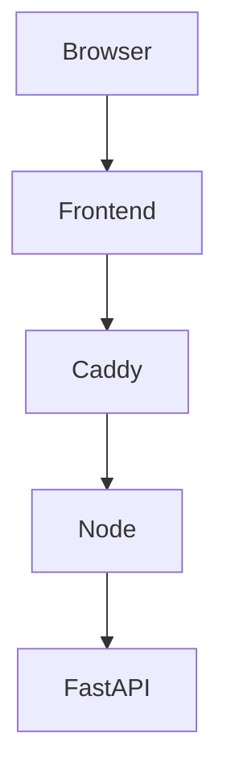

# web-java-aql-query

## Description
A secured api/frontend for the AQL platform.
Features
- Ad hoc queries
- Query wizard
- System sources

---

## Endpoints
These endpoint can also be reached with 
```bash
curl -ikL localhost
```
while services are running.

### /api/query/submit/{query}
Creates async job, to execute query

### /api/query/reaults/{jobId}
Returns results of query.

### /api/system/list
Displays all possible system sources.

### /api/system/fields/{source}
Returns names of fields in a given source

### /api/system/{source}
Shows individual sources.

### /api/index
Shows README from AQL.

---

## To run

### Start services
```bash
docker compose up --build
```

### View frontend
[localhost](https://localhost)

### Health check
```bash
curl -ikL localhost/health
```

### Call API
```bash
curl -ikL localhost/api/data
```

### Run playwrite tests
```bash
docker compose --profile test up
```

### Stop services
```bash
docker compose down
```

### Cleanup docker
```bash
docker volume prune && docker system prune
```
---

## Services

### Caddy
Reverse proxy with additional rate limit plugin. Manages self-signed ssl certificates.

### FastAPI
A python based api only gateway protected by docker secrets file. Being python based, can use `subprocess` function to make external calls to AQL platform applications.

### Frontend
A Java / React simple page that displays api data.

### Node
A nodejs express BFF (backend for frontend) gateway protected by docker secrets file.

### Playwrite
Tests browser and api.

---

## Creating docker secrets
```bash
openssl rand -hex 32
```

---

## How docker secrets are shared
```text
             Docker secret
                  │
          ┌───────┴────────┐
          ▼                ▼
       Node.js           FastAPI
          │                │
          └── same key ────┘
```

---
## Network Flow

```text
                  PUBLIC
        ┌───────────┼───────────┐
        │           │           │
      Caddy      frontend     MinIO
        │                       │
        │                       │
        └───────────────────────┘

                  BACKEND
        ┌───────────┼───────────┐
        │           │           │
       Node      FastAPI       MinIO
```
---

## System Flow



## Reference
This is a web implementation of a [CLI tool](https://github.com/bearddaniel80-netizen/aql-public.git).